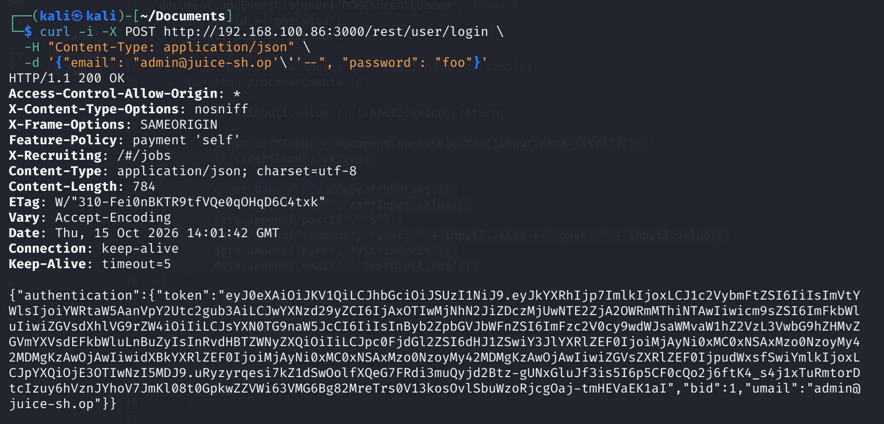
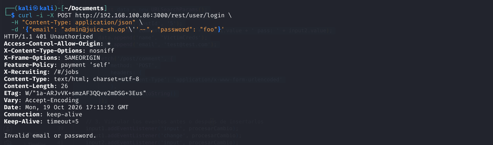
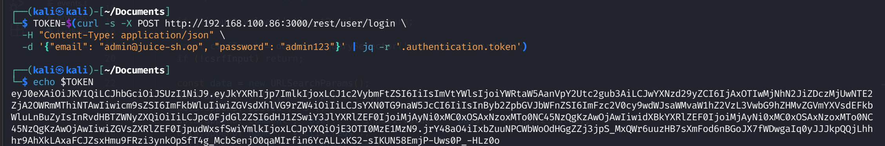
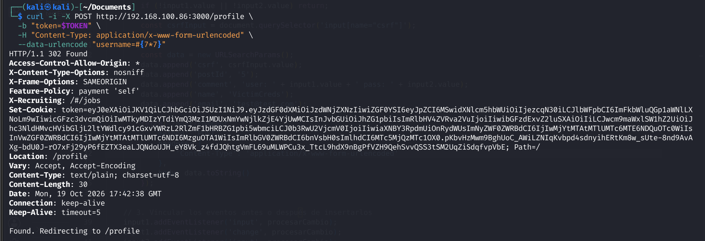
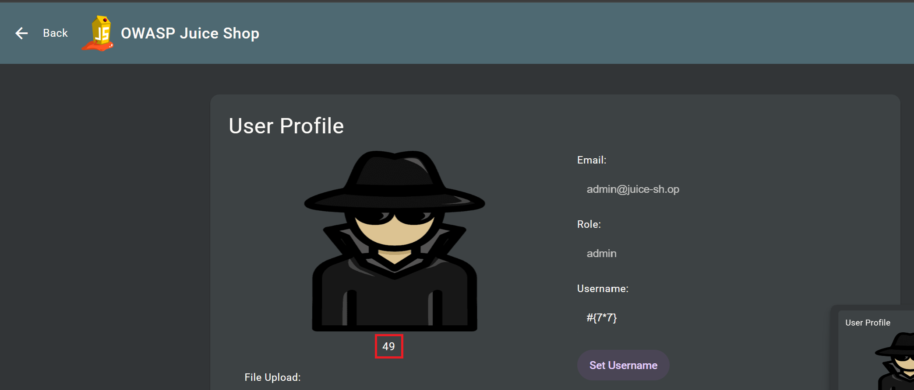
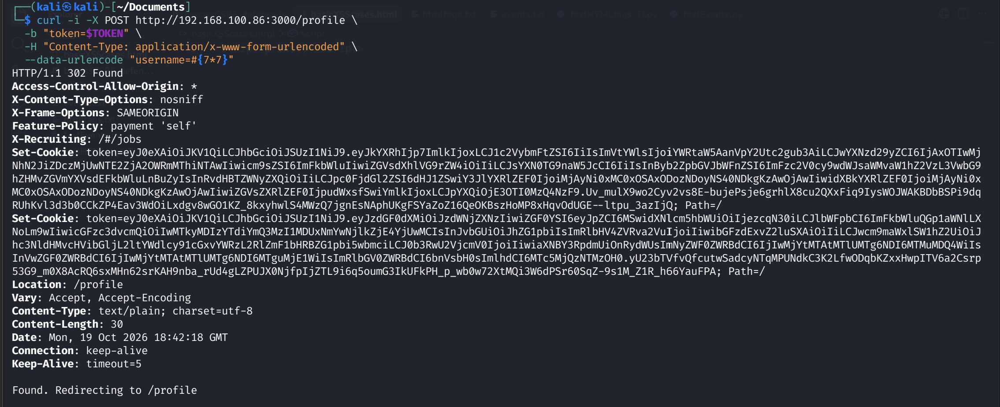
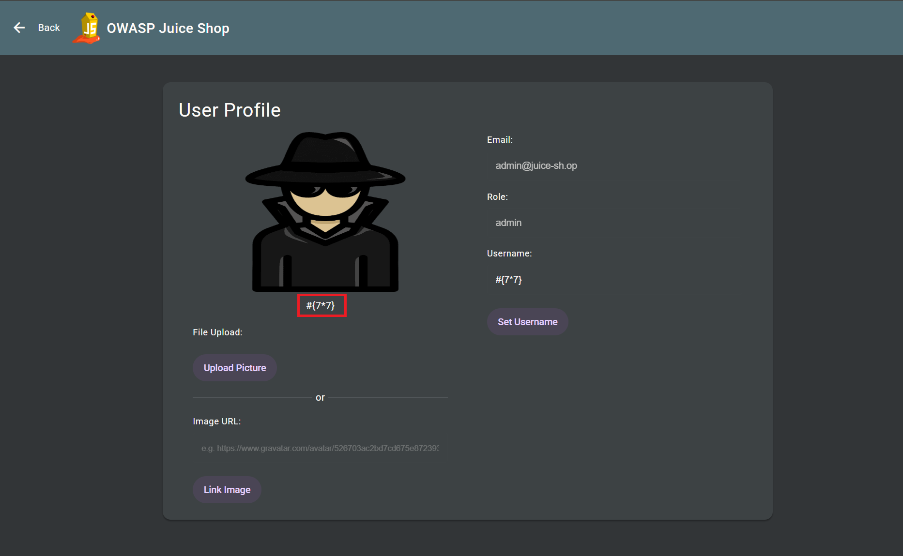
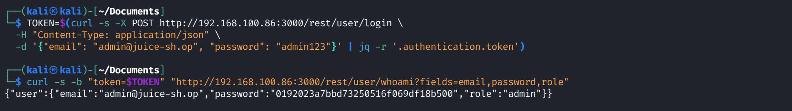
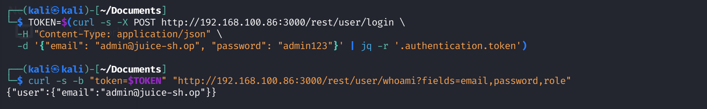

# secure-code-fixes

Real remediation of static-analysis findings, documented in a pull-request style: root cause, impact, proof of concept, fix, and verification.

> **Target:** [OWASP Juice Shop](https://github.com/juice-shop/juice-shop), an application that is intentionally vulnerable. The vulnerable code in this repo is **not mine**; it comes from upstream (MIT license). Only the fixes are my work. Everything was tested locally, on my own instance. The vulnerable code stays on `master` of my fork (it feeds a separate CI/CD security pipeline project); the fixes live on the [`secure-code-fixes-demo`](https://github.com/martinngreco/appsec-pipeline/tree/secure-code-fixes-demo) branch.

## Summary

| # | Finding | File | Class | Verified with |
|---|---------|------|-------|---------------|
| 1 | SQL injection (login + product search) | `routes/login.ts`, `routes/search.ts` | Injection (CWE-89) | Auth bypass & UNION payloads fail, search still works, Semgrep clean |
| 2 | Code / template injection via username | `routes/userProfile.ts`, `views/userProfile.pug` | Code injection (CWE-94 / CWE-1336) | 3 Pug interpolation payloads tested and blocked, Semgrep clean |
| 3 | Arbitrary property read via bracket notation | `routes/currentUser.ts` | Excessive data exposure / property injection (CWE-915 / CWE-200) | Sensitive fields no longer returned, Semgrep clean |

**Method for each finding:** Semgrep detects it, I confirm it is a true positive with a PoC, fix it on its own commit, then re-run the PoC and Semgrep to prove the fix.

---

## Fix 1: SQL injection in the login route

- **Where:** `routes/login.ts`
- **Semgrep rule:** `javascript.sequelize.security.audit.sequelize-injection-express.express-sequelize-injection` (severity: error)

### Root cause

The login query is built with a template string, so `req.body.email` goes straight into the SQL text:

```ts
models.sequelize.query(`SELECT * FROM Users WHERE email = '${req.body.email || ''}' AND password = '${security.hash(req.body.password || '')}' AND deletedAt IS NULL`, { model: UserModel, plain: true })
```

### Impact

An attacker can close the string and comment out the rest of the query, which skips the password check and logs in as any user, including the admin.

### Proof of concept (before the fix)

```bash
curl -s -X POST http://localhost:3000/rest/user/login \
  -H 'Content-Type: application/json' \
  -d '{"email":"admin@juice-sh.op'"'"'--","password":"x"}'
```

The server returns a valid authentication token.



### The fix

User input is passed as parameters instead of being concatenated into the query:

```diff
-    models.sequelize.query(`SELECT * FROM Users WHERE email = '${req.body.email || ''}' AND password = '${security.hash(req.body.password || '')}' AND deletedAt IS NULL`, { model: UserModel, plain: true }) // vuln-code-snippet vuln-line loginAdminChallenge loginBenderChallenge loginJimChallenge
-      .then((authenticatedUser) => { // vuln-code-snippet neutral-line loginAdminChallenge loginBenderChallenge loginJimChallenge
+    models.sequelize.query(
+      'SELECT * FROM Users WHERE email = :email AND password = :password AND deletedAt IS NULL',
+      {
+        replacements: {
+          email: req.body.email || '',
+          password: security.hash(req.body.password || '')
+        },
+        model: UserModel,
+        plain: true
+      }
+    )
+    .then((authenticatedUser) => { // vuln-code-snippet neutral-line loginAdminChallenge loginBenderChallenge loginJimChallenge
```

**`replacements` vs `bind`.** Sequelize offers two ways to parameterize:

- `replacements` (used here): Sequelize escapes the values and inserts them into the SQL string **before** sending it to the database.
- `bind`: the query and the values travel separately and the database driver handles the parameters, so the structure of the query is fixed before any data arrives. This is the stricter option.

Both stop this injection when used correctly. `bind` is the better default for new code.

**Same fix using `bind`** (stricter alternative):

```ts
models.sequelize.query(
  'SELECT * FROM Users WHERE email = $email AND password = $password AND deletedAt IS NULL',
  {
    bind: {
      email: req.body.email || '',
      password: security.hash(req.body.password || '')
    },
    model: UserModel,
    plain: true
  }
)
```

The syntax differs slightly: `replacements` uses `:name` placeholders, while `bind` uses `$name` (or `$1`, `$2`, ...).

### Verification

- The same payload now returns `401 Unauthorized`.
- A legitimate login still works.
- Semgrep no longer reports the finding on this line.



### Notes

- This fix makes the login-related Juice Shop challenges unsolvable, which is expected.
- Out of scope: `security.hash` uses MD5, which is a separate weakness (fast, unsalted hashing).

### A second instance of the same pattern

The same rule (`express-sequelize-injection`) also flagged `routes/search.ts`, where the product search term was concatenated into a raw query:

```ts
models.sequelize.query(`SELECT * FROM Products WHERE ((name LIKE '%${criteria}%' OR description LIKE '%${criteria}%') AND deletedAt IS NULL) ORDER BY name`)
```

This one is more severe: it's **unauthenticated** and the `LIKE` context makes it straightforward to pivot into a UNION-based injection that reads arbitrary tables, including `Users` (email, password hash).

The fix follows the same principle as the login query — stop building SQL from strings — here by replacing the raw query with Sequelize's query builder:

```diff
-    models.sequelize.query(`SELECT * FROM Products WHERE ((name LIKE '%${criteria}%' OR description LIKE '%${criteria}%') AND deletedAt IS NULL) ORDER BY name`)
+    const searchPattern = `%${criteria}%`
+    ProductModel.findAll({
+      where: {
+        [Op.or]: [
+          { name: { [Op.like]: searchPattern } },
+          { description: { [Op.like]: searchPattern } }
+        ]
+      },
+      order: [['name', 'ASC']]
+    })
```

**One detail this change requires:** `sequelize.query` resolves to a `[rows, metadata]` tuple, so the original `.then(([products]: any) => ...)` correctly destructured it. `ProductModel.findAll()` resolves directly to the array of rows — so the destructuring has to change to `.then((products: any) => ...)`, or only the first product would be processed.

**Verified:** a UNION payload no longer returns data from other tables, a normal search (`?q=a`) still returns every matching product, and Semgrep no longer reports the finding on this line.

---

## Fix 2: Code and template injection through the username

- **Where:** `routes/userProfile.ts`
- **Semgrep rule:** `javascript.lang.security.audit.code-string-concat.code-string-concat` (severity: error)

### Root cause

Two problems stacked on the same input:

1. The username, which the user controls, flowed into `eval`.
2. The username was substituted into the Pug template source **before** the template was compiled, so Pug treated it as template code. Pug evaluates JavaScript inside its interpolation syntax (`#{...}`).

### Impact

Execution of attacker-controlled code in the context of the application process.

### Proof of concept (before the fix)

A harmless payload, only to show that the input is evaluated. Set the username to:

```
#{7*7}
```

The profile page renders `49` instead of the literal text.






### The first attempt (string-escaping) — and why it wasn't enough

```diff
-    let username = user.username
+    let username = user.username || ''

-    if (utils.isChallengeEnabled(challenges.usernameXssChallenge)) {
-      if (username?.match(/#{(.*)}/) !== null) {
-        req.app.locals.abused_ssti_bug = true
-        const code = username?.substring(2, username.length - 1)
-        try {
-          if (!code) {
-            throw new Error('Username is null')
-          }
-          username = eval(code) // eslint-disable-line no-eval
-        } catch (err) {
-          username = '\\' + username
-        }
-      } else {
-        username = '\\' + username
-      }
-      if (username) {
-        template = template.replace(/_username_/g, username)
-      }
-    } else {
-      template = template.replace(/_username_/g, '#{username}')
-    }

+    const safeUsername = entities.encode(username).replace(/#{/g, '\\#{')
+    template = template.replace(/_username_/g, safeUsername)
```

This removes the `eval` call and escapes `#{`. It stops the original PoC (`#{7*7}`), but testing other Pug interpolation forms revealed it doesn't actually solve the problem:

- `!{7*7}` (Pug's unescaped interpolation): still evaluated to `49`.
- `#[b 7*7]` (Pug's tag interpolation): still rendered an actual `<b>7*7</b>` tag — HTML injection.

**Why:** this approach inserts the (partially escaped) username directly into the **template source string** before compiling it, so Pug still parses whatever is left as code. Escaping one interpolation syntax at a time doesn't scale — Pug has several, and there's no guarantee all are covered.

### The actual fix: stop treating the username as template source

The route already passes the whole `user` object as render locals (`res.send(fn(user))`), so the template just needed to reference `username` as a variable instead of having it string-replaced into the source:

```diff
-    let username = user.username || ''
+    const username = user.username || ''

     const themeKey = config.get<string>('application.theme') as keyof typeof themes
     const theme = themes[themeKey] || themes['bluegrey-lightgreen']   

-    const safeUsername = entities.encode(username).replace(/#{/g, '\\#{')
-    template = template.replace(/_username_/g, safeUsername)
-
     template = template.replace(/_emailHash_/g, security.hash(user?.email))
```

And in `views/userProfile.pug`:

```diff
-                  p(style='margin-top: 8px; color: _textColor_; text-align: center;') _username_
+                  p(style='margin-top: 8px; color: _textColor_; text-align: center;') #{username}
```

`#{username}` here is written in the `.pug` file I control, compiled once with `pug.compile(template)`. At render time Pug substitutes the *value* of `username` with HTML auto-escaping — it never re-parses that value as Pug syntax again, regardless of what characters it contains. This is the same principle as a parameterized SQL query: data and code stop sharing the same channel.

### Verification

- `#{7*7}`: renders as literal text.
- `!{7*7}`: renders as literal text (previously evaluated to `49`).
- `#[b 7*7]`: renders as literal text (previously rendered an actual `<b>` tag).
- Semgrep no longer reports the finding.




---

## Fix 3: Arbitrary property read through bracket notation

- **Where:** `routes/currentUser.ts`
- **Semgrep rule:** `javascript.express.security.audit.remote-property-injection.remote-property-injection` (severity: error)

### Root cause

The `fields` query parameter decides which properties of the user object are returned, and it is used directly as a key:

```ts
for (const field of requestedFields) {
  if (user?.data[field as keyof typeof user.data] !== undefined) {
    baseUser[field] = user?.data[field as keyof typeof user.data]
  }
}
```

### Impact

The client chooses which attributes of the user record come back, so it can read internal and sensitive ones that the endpoint was never meant to expose (see the PoC). Bracket notation with attacker-controlled keys can also reach prototype properties.

### Proof of concept (before the fix)



### The fix

An explicit allow-list: only four known properties can ever be returned, each assigned with a literal property name.

```diff
let baseUser: any = {}
-
+        const baseUser: Record<string, any> = {}
+        
         if (requestedFields.length > 0) {
-          // When fields are specified, return only those fields
-          for (const field of requestedFields) {
-            if (user?.data[field as keyof typeof user.data] !== undefined) {
-              baseUser[field] = user?.data[field as keyof typeof user.data]
-            }
+          // Direct assignments  to neutralize remote-property-injection
+          if (requestedFields.includes('id') && user?.data?.id !== undefined) {
+            baseUser.id = user.data.id
           }
-        } else {
-          // If no fields parameter, return standard fields (not password field)
-          baseUser = {
-            id: user?.data?.id,
-            email: user?.data?.email,
-            lastLoginIp: user?.data?.lastLoginIp,
-            profileImage: user?.data?.profileImage
+          if (requestedFields.includes('email') && user?.data?.email !== undefined) {
+            baseUser.email = user.data.email
           }
+          if (requestedFields.includes('lastLoginIp') && user?.data?.lastLoginIp !== undefined) {
+            baseUser.lastLoginIp = user.data.lastLoginIp
+          }
+          if (requestedFields.includes('profileImage') && user?.data?.profileImage !== undefined) {
+            baseUser.profileImage = user.data.profileImage
+          }
+        } else {
+          baseUser.id = user?.data?.id
+          baseUser.email = user?.data?.email
+          baseUser.lastLoginIp = user?.data?.lastLoginIp
+          baseUser.profileImage = user?.data?.profileImage
```

The allow-list is the real security control. Using literal property names also removes the dynamic key access that the static rule flags.

### Verification

- Requesting any attribute outside the allow-list returns nothing for it.
- The legitimate use of the endpoint (allowed fields, and no `fields` parameter) still works.
- Semgrep no longer reports the finding.



---

## Triage of the remaining Semgrep findings

| Rule | Locations | Decision |
|------|-----------|----------|
| `express-sequelize-injection` | 6 | 2 fixed (Fix 1: `login.ts` and `search.ts`). The other 4 locations are inside Juice Shop's own challenge-solution snippets (`*Challenge_1.ts`, `*Challenge_3.ts`), not live routes — out of scope |
| `run-shell-injection` (GitHub Actions) | 5 | Out of scope: upstream workflows are disabled in my fork (moved to `.github/workflows/notUsed`) so that only my own pipeline runs |
| `gha-curl-pipe-shell` | 1 | Out of scope, same reason (`curl \| sh` in a disabled workflow) |
| `detected-jwt-token` | 3 | False positive: example JWTs hardcoded in unit test fixtures (`app.guard.spec.ts`, last-login-ip spec), not real tokens |
| `detected-generic-secret` | 1 | False positive: seed account (`wurstbrot`) in `users.yml`, used by one of Juice Shop's own challenges — not a real credential |

Semgrep analyzes files, not whether a workflow actually runs, so the disabled workflows still show up in the scan results.

## Reproducing

The easiest way to see the fixes in context is the GitHub compare view, which shows the full diff for all 4 commits side by side with the vulnerable code:

**[Compare `master` (vulnerable) → `secure-code-fixes-demo` (fixed)](https://github.com/martinngreco/appsec-pipeline/compare/master...secure-code-fixes-demo)**

Or browse the fixed code directly on the [`secure-code-fixes-demo`](https://github.com/martinngreco/appsec-pipeline/tree/secure-code-fixes-demo) branch.

Alternatively, apply the patches from this repo to a clone of my fork at the base commit:

```bash
git clone https://github.com/martinngreco/appsec-pipeline
cd appsec-pipeline
git checkout ce68e94ad
git apply /path/to/secure-code-fixes/patches/<patch-file>.patch
npm install && npm run build:server && npm start
```

## Repo layout

```
secure-code-fixes/
├── README.md
├── patches/     # one .patch per fix (git format-patch)
└── evidence/    # PoC screenshots, before and after
```

## References

- [OWASP Juice Shop](https://owasp.org/www-project-juice-shop/)
- [OWASP SQL Injection Prevention Cheat Sheet](https://cheatsheetseries.owasp.org/cheatsheets/SQL_Injection_Prevention_Cheat_Sheet.html)
- [Sequelize raw queries (replacements and bind)](https://sequelize.org/docs/v6/core-concepts/raw-queries/)
- [Pug interpolation](https://pugjs.org/language/interpolation.html)

## Repository & Code Changes

All security mitigations are implemented as atomic commits and hosted in the target repository branch:

- **Remediation Branch:** [appsec-pipeline@secure-code-fixes-demo](https://github.com/martinngreco/appsec-pipeline/tree/secure-code-fixes-demo)
- **Full Pull Request / Compare Diff:** [Compare Changes](https://github.com/martinngreco/appsec-pipeline/compare/master...secure-code-fixes-demo)
